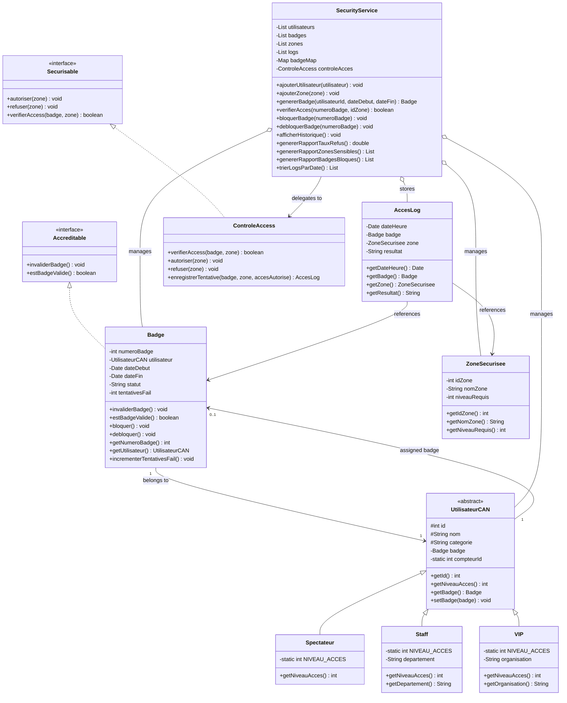
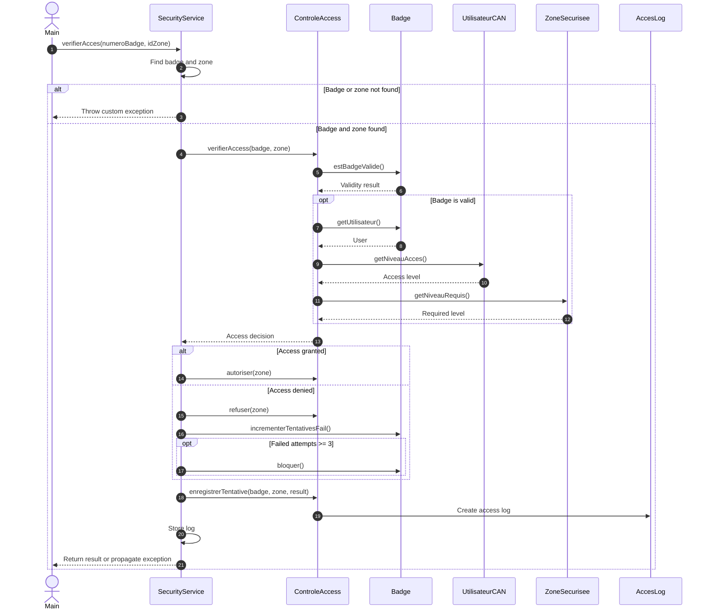

# 🏆 CAN Event Access Control & Security System

<p align="center">
  A Java application for managing access permissions, security badges, and access audit logs for CAN stadium zones.
</p>

<p align="center">
  
  
  
</p>

## 📌 Overview

**CAN-M-Java** is an object-oriented Java application that simulates a badge-based access control system for the *Coupe d'Afrique des Nations (CAN) in Morocco*.

The application manages users with different access levels, generates time-limited security badges, verifies permissions to enter secured zones, records access decisions, and generates security reports.

It demonstrates core software engineering concepts, including inheritance, polymorphism, interfaces, encapsulation, exception handling, collections, and separation of business logic from domain models.

## ✨ Key Features

### 👥 User and Access-Level Management

The application defines three user categories:

| User type | Access level | Example of authorized zone |
|---|---:|---|
| `Spectateur` | 1 | Stadium entrance |
| `Staff` | 2 | Backstage |
| `VIP` | 3 | VIP zone |

Access is granted when the badge is valid and the user's access level meets or exceeds the zone's required security level.

### 🎫 Security Badge Management

- Generate badges for registered users.
- Define badge validity periods using start and end dates.
- Maintain badge states: `VALIDE`, `INVALIDE`, and `BLOQUE`.
- Invalidate, block, and unblock badges.
- Track failed access attempts.
- Derive badge numbers using Java's `hashCode()`.

### 🔐 Access Control

- Validate badge status and validity dates.
- Compare user access levels with zone security requirements.
- Authorize or reject access requests.
- Block a badge after three failed access checks.
- Raise custom exceptions for invalid badges, denied access, invalid data, and inaccessible zones.

**Note:** The current implementation accumulates failed attempts. Successful access does not reset the counter automatically.

### 📋 Audit Logging and Security Reports

- Record access decisions with timestamps.
- Associate each log entry with a badge and a secured zone.
- Display the access history.
- Calculate the access rejection rate.
- Identify zones with the highest number of rejected attempts.
- Retrieve the list of blocked badges.
- Sort access logs chronologically.

Logs and application data are stored in memory for the duration of the execution; no database persistence is implemented.

---

## 🏗️ Architecture

The application separates domain models, access-control services, interfaces, custom exceptions, and the entry point.

### UML Class Diagram



### Access Verification Sequence



### Interactive Repository Diagram

Explore the repository structure using GitDiagram:

👉 **[View CAN-M-Java on GitDiagram](https://gitdiagram.com/Ellouzati-Mohammed/CAN-M-Java)**

---

## 📂 Project Structure

```text
CAN-M-Java/
├── src/
│   ├── Main.java
│   ├── Exception/
│   │   ├── AccesRefuseException.java
│   │   ├── BadgeInvalideException.java
│   │   ├── DonneeInvalideException.java
│   │   └── ZoneInterditeException.java
│   ├── Interface/
│   │   ├── Accreditable.java
│   │   └── Securisable.java
│   ├── model/
│   │   ├── AccesLog.java
│   │   ├── Badge.java
│   │   ├── Spectateur.java
│   │   ├── Staff.java
│   │   ├── UtilisateurCAN.java
│   │   ├── VIP.java
│   │   └── ZoneSecurisee.java
│   └── service/
│       ├── ControleAccess.java
│       └── SecurityService.java
├── .gitignore
├── Can_M.iml
└── README.md
```

### Main Components

| Component | Responsibility |
|---|---|
| `Main` | Creates sample users, zones, and badges; runs access-control scenarios. |
| `model` | Represents users, badges, secure zones, and access logs. |
| `service` | Implements access verification, badge administration, logging, and reports. |
| `Interface` | Defines badge-validation and access-control contracts. |
| `Exception` | Defines custom exceptions for access and data errors. |

---

## 🛠️ Technologies and Concepts

- **Java 8 or later**
- **Object-Oriented Programming:** inheritance, abstraction, encapsulation, and polymorphism.
- **Interfaces:** explicit contracts for accreditation and access control.
- **Java Collections:** `List`, `Map`, and `HashMap`.
- **Java Streams:** filtering, sorting, grouping, and report generation.
- **Exception Handling:** custom runtime exceptions.
- **UML and Mermaid:** class and sequence diagrams.

The application uses the Java standard library and does not require an external database or third-party framework.

---

## 🚀 Getting Started

### Prerequisites

- JDK 8 or later.
- Git.
- IntelliJ IDEA or another Java IDE (optional).

Verify your installation:

```bash
java -version
javac -version
```

### 1. Clone the Repository

```bash
git clone https://github.com/Ellouzati-Mohammed/CAN-M-Java.git
cd CAN-M-Java
```

### 2. Compile the Application

On **Windows PowerShell**, run:

```powershell
$files = Get-ChildItem -Path src -Recurse -Filter *.java |
    ForEach-Object { $_.FullName }

New-Item -ItemType Directory -Force bin | Out-Null
javac -d bin $files
```

### 3. Run the Application

```powershell
java -cp bin Main
```

Alternatively, open the project in IntelliJ IDEA, configure the JDK, and run `Main.java`.

### 4. Example Scenarios

The entry point demonstrates:

- A spectator accessing the entrance successfully.
- A spectator being rejected from the backstage area.
- Repeated failed attempts leading to badge blocking.
- A staff member accessing the backstage area.
- A VIP accessing the VIP zone.
- Displaying access history and reporting the rejection rate and blocked badges.

---


- GitHub: [@Ellouzati-Mohammed](https://github.com/Ellouzati-Mohammed)
- LinkedIn: [Mohammed Ellouzati](https://www.linkedin.com/in/mohammed-ellouzati-359873270)
- Email: [mohammedellouzati047@gmail.com](mailto:mohammedellouzati047@gmail.com)

---

<p align="center">
  <i>Applying object-oriented design to access control and security management.</i>
</p>
