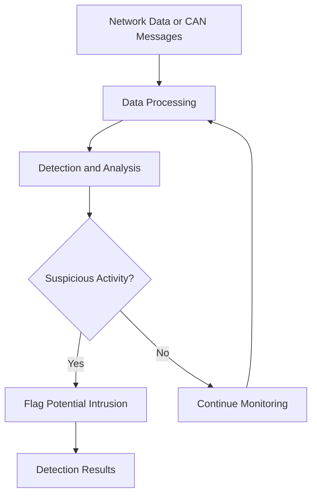

# CAN-M-Java

<p align="center">
  <strong>CAN Network Intrusion Detection System</strong>
  <br/>
  A Java-based project focused on network security and intrusion detection.
</p>

<p align="center">
  
  
  
</p>

## 📌 Overview

**CAN-M-Java** is a Java project developed to explore network security and intrusion detection concepts. It focuses on applying software engineering principles to security-oriented applications.

The project provides an opportunity to work with Java programming, application design, and the analysis of potentially suspicious network activity.

## 🎯 Objectives

- Explore network intrusion detection concepts.
- Apply object-oriented programming principles in Java.
- Develop a structured and maintainable application.
- Understand how software components can contribute to a security monitoring workflow.

## 🏗️ Architecture

Explore the project's interactive architecture diagram generated with GitDiagram:

**[View CAN-M-Java Architecture](https://gitdiagram.com/Ellouzati-Mohammed/CAN-M-Java)**

The following diagram illustrates a conceptual intrusion detection workflow. It is not a verified representation of the implementation.



## 🛠️ Technologies

- **Programming Language:** Java
- **Java Platform:** Java 17
- **Software Engineering:** Object-Oriented Programming (OOP)
- **Development Environment:** IntelliJ IDEA

## 🚀 Getting Started

### Prerequisites

- Java Development Kit (JDK) 17 or compatible.
- Git.
- IntelliJ IDEA or another Java-compatible IDE.

Verify your Java installation:

```bash
java -version
javac -version
```

### Installation

Clone the repository:

```bash
git clone https://github.com/Ellouzati-Mohammed/CAN-M-Java.git
```

Navigate to the project directory:

```bash
cd CAN-M-Java
```

### Run the Application

1. Open the project in IntelliJ IDEA.
2. Configure JDK 17 as the project SDK.
3. Locate the application's entry point containing the `main` method.
4. Run the main class from the IDE.

The exact compilation and execution commands depend on the project's source structure and entry-point class.

## 📂 Project Structure

The repository contains Java source code under `src/`. Explore the source files to identify the application's main components and implementation details.

For a visual overview of the codebase, use [GitDiagram](https://gitdiagram.com/Ellouzati-Mohammed/CAN-M-Java).

## 📚 Concepts

This project relates to the following areas:

- Java programming and object-oriented design.
- Network security fundamentals.
- Intrusion detection concepts.
- Application architecture and code organization.


---

<p align="center">
  <i>Exploring Java development and network security through practical implementation.</i>
</p>
